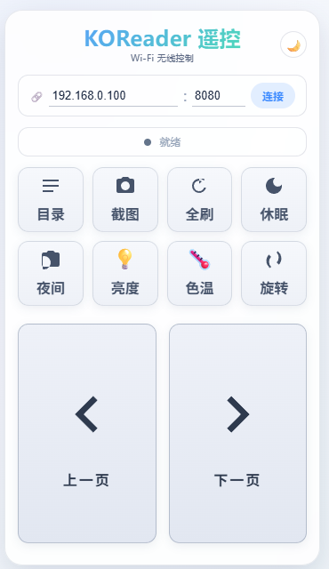

# KOReader 遥控器

[](https://github.com/seaneasysaid/koreader-remote/releases)

用手机遥控你的 KOReader 阅读器。

一个**纯前端**（HTML/CSS/JS）的无线遥控页面，直接调用 KOReader 自带的 HTTP 接口，
不经过任何第三方服务器，无需安装插件、无需后端。除了在浏览器里打开，
也可以装成**安卓 App** 使用。

| 方式 | 适合场景 | 入口 |
|------|----------|------|
| 🌐 **网页版** | 手机/电脑浏览器直接用，零安装 | [在线打开](https://seaneasysaid.github.io/koreader-remote/) |
| 📱 **安卓 App** | 常驻使用，音量键翻页、截图存手机 | [下载 APK](https://github.com/seaneasysaid/koreader-remote/releases) |

---

## 功能

- **翻页**：上一页 / 下一页，也支持大跨度翻页、跳章节、首末页、随机页
- **阅读控制**：目录、书签、字号、底部菜单、状态栏、返回、文件浏览器
- **屏幕**：全屏刷新（墨水屏整屏重绘）、旋转 90°、夜间模式
- **前光**：亮度 / 色温 ＋1 −1，前光开关（长按按钮可连发）
- **设备**：休眠、Wi‑Fi 开关
- **截图**：获取设备当前屏幕 PNG
  - 网页版：保存到本机（`file://` 下改为新标签打开，需手动保存）
  - 安卓 App：原生桥直接写入系统「下载」目录
- **键盘 / 蓝牙翻页笔**：完整按键映射，PPT 翻页笔插上即用
- **日间 / 夜间主题**：右上角 ☀️/🌙 切换页面自身主题（仅影响遥控界面，不影响设备）

## 界面预览



*4×2 功能按钮 + 双大翻页按钮，低饱和淡蓝灰玻璃态*

---

## 快速开始

### 1. 准备设备端

1. **查到设备 IP**：KOReader → **设置 → 网络 → 查看网络信息**，记下 IP（形如 `192.168.0.100`）。
2. **打开 HTTP 服务**：进入 KOReader **HTTP 调试器**，设置监听**端口**（例如 `8080`）。
3. **确认同一网络**：手机/电脑需与阅读器在**同一个 Wi‑Fi（同一网段）**下。

### 2. 连接

1. 打开页面（网页版或 App）。
2. 填入设备 IP 与端口（默认 `192.168.0.100:8080`）。
3. 点 **连接**：
   - 显示「连接成功 ✓」即可开始遥控；
   - 超时或被拒绝会给出提示，请核对 IP、端口，并确认设备端服务已启动。
4. IP 与端口会保存在本地，下次打开自动回填。

### 3. 开始使用

点按钮即可。用翻页笔或键盘时，见下方[按键映射](#键盘--蓝牙翻页笔)。

---

## 功能按钮一览

| 按钮 | 作用 | KOReader 事件 |
|------|------|---------------|
| 上一页 / 下一页 | 翻页 | `GotoViewRel/-1`、`GotoViewRel/1` |
| 目录 | 打开书籍目录 | `ShowToc` |
| 截图 | 获取设备当前屏幕 PNG | `GET /koreader/device/screen/bb` |
| 全刷 | 强制全屏刷新（墨水屏整屏重绘） | `FullRefresh` |
| 休眠 | 让设备进入休眠 | `RequestSuspend` |
| 夜间 | 切换设备夜间模式 | `ToggleNightMode` |
| 亮度 💡 | 二级弹层 ＋1 / −1 | `IncreaseFlIntensity/1`、`DecreaseFlIntensity/1` |
| 色温 🌡️ | 二级弹层 ＋1 / −1 | `IncreaseFlWarmth/1`、`DecreaseFlWarmth/1` |
| 旋转 | 屏幕顺时针旋转 90° | `IterateRotation` |

> 所有指令都以 KOReader 的**事件名（Event）**广播下发，因此事件名必须与
> KOReader 内部事件名**完全一致**（驼峰式）。非原生事件名（如 `Rotate`、
> `full_refresh`）不会生效。

---

## 键盘 / 蓝牙翻页笔

点右上角 **⌨️** 可查看当前生效的完整映射（面板内容由实际映射表反查生成，不会与实际脱节）。

### 翻页（翻页笔默认键）

| 按键 | 动作 |
|------|------|
| `PageUp` / `←` / `↑` | 上一页 |
| `PageDown` / `→` / `↓` / `空格` / `回车` | 下一页 |
| `Backspace` | 上一页 |
| 翻页笔的 `上一曲/下一曲`、`浏览器后退/前进` | 上 / 下一页 |

### 快速跳转

| 按键 | 动作 |
|------|------|
| `Shift` + `PageUp` / `PageDown` | 上 / 下 10 页 |
| `Ctrl` + `←` / `→` | 上 / 下 10 页 |
| `Shift` + `←` / `→`、`Ctrl` + `PageUp` / `PageDown` | 上 / 下一章 |
| `Shift/Ctrl` + `Home` / `End` | 第一页 / 最后一页 |
| `P` | 随机页 |
| `G` | 跳页对话框 |

### 阅读

| 按键 | 动作 |
|------|------|
| `T` | 目录 |
| `B` | 加 / 去书签 |
| `M` | 底部菜单 |
| `U` | 状态栏 |
| `H` | 文件浏览器 |
| `Esc` | 返回 |
| `Alt` + `↑` / `↓` | 字号 ＋ / − |

### 屏幕与前光

| 按键 | 动作 |
|------|------|
| `N` | 夜间模式 |
| `F` / `F5` | 全屏刷新 |
| `R` | 顺时针旋转 90° |
| `Shift` + `R` | 逆时针旋转 90° |
| `L` | 前光开关 |
| `+` / `=` / `]` | 亮度 ＋1 |
| `-` / `_` / `[` | 亮度 −1 |
| `Shift` + `.` / `Shift` + `↑` | 色温 ＋1 |
| `Shift` + `,` / `Shift` + `↓` | 色温 −1 |
| `F11` / `Shift` + `F` | 全屏切换 |

### 其他

| 按键 | 动作 |
|------|------|
| `S` | 截图 |
| `Z` | 休眠 |
| `W` | Wi‑Fi 开关 |

---

## 部署 / 更新（GitHub Pages）

仓库根目录即网页版源码，改动后把以下文件推到 `main` 即可自动发布：

- `index.html`（页面本体）
- `icon-192.png`、`icon-512.png`
- `README.md`

```bash
git add index.html icon-192.png icon-512.png README.md
git commit -m "update: 页面/文档更新"
git push origin main
```

仓库 **Settings → Pages → Source** 选 **Deploy from a branch**，
**Branch** 选 `main`，目录选 **/ (root)**。约 1 分钟后生效：
<https://seaneasysaid.github.io/koreader-remote/>

### 本地直接打开

纯静态文件，双击 `index.html` 即可用。仅在 `file://` 下「截图」会改为
新标签页打开图片，需要手动保存。

---

## 安卓 App

把同一个遥控页面打包成安卓 App：**WebView 壳 + 离线内嵌页面**。

- 🔊 **音量键翻页**：音量上 = 上一页，音量下 = 下一页；App 内可切换「翻页 / 调音量」
- 📸 **截图存手机**：通过原生桥直接写入系统「下载」目录
- 📦 **离线内嵌**：打开即用，无需联网加载界面

下载安装包：[**Releases**](https://github.com/seaneasysaid/koreader-remote/releases)
→ `koreader-remote-v1.0.0.apk`（允许「未知来源」即可安装）

源码、构建与安装说明见 **[koreader-apk/](koreader-apk/)**。

---

## 说明与限制

- 仅支持 KOReader 自带的 HTTP 控制接口，需要设备端开启服务。
- 指令与设备在同一局域网内**直连**，不经过任何第三方服务器。
- 默认 IP / 端口可在 `index.html` 里搜索 `192.168.0.100` 与 `8080` 修改后重新部署。
- 事件名必须与 KOReader 内部事件名一致，否则无效。
